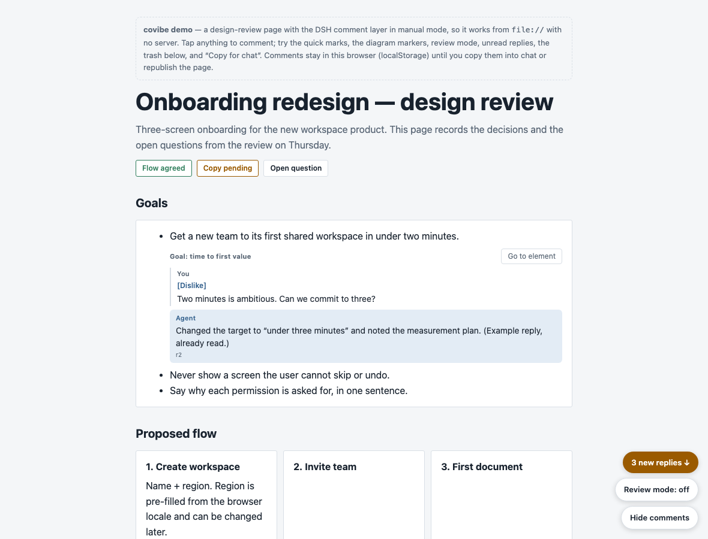

# covibe for DSH

A DSH port of **covibe 1.1** (the platform-agnostic covibe skill): turn a
design, plan, architecture or decision into a **commentable page**, let the user
annotate it in place, and republish at the same URL as comments arrive.

The original skill was written for Claude artifacts. DSH has no artifact host and no
native artifact comments, so this port supplies the three delivery functions itself:

| Function | How it works here |
|---|---|
| A stable URL for the page | `scripts/covibe_server.py serve` publishes `<page-dir>/publish/` on `127.0.0.1:8787` (loopback only) |
| Keep the comments | The page POSTs each batch; the server appends one JSON line to `.covibe/comments.jsonl` (with `seq`); unsent comments stay in the page's localStorage |
| Start the agent's session | `scripts/covibe_server.py wait` is a short-lived **background job**; it exits when a comment arrives. In DSH a finished job owned by an idle agent opens a new turn (`completionDelivery: "wakeup"`), so the agent resumes by itself |

That last point is why this port is possible at all, and why the same trick does not
work in Codex: Codex has no job-completion wake that starts a new turn for an idle
agent.



## Requirements

- DSH 0.2.1-rc.3 or newer. The wake step relies on its job-completion delivery
  (`completionDelivery: "wakeup"`): a finished background job opens a new turn for an
  idle agent. If a future version changes that, use manual mode (see
  `references/dsh.md` for the fallback).
- Python 3.8+ (the page server and the publisher use the standard library only).
- Node 18+ for `node test/run.js` (tests only; nothing to install).

## Install

Put this directory where DSH discovers skills:

```bash
mkdir -p ~/.dsh/skills
cp -R covibe-dsh ~/.dsh/skills/covibe      # or <project>/.dsh/skills/covibe
```

DSH scans, in order of precedence: `<project>/.dsh/skills`, `<project>/.agents/skills`,
custom dirs, `~/.dsh/skills`, `~/.agents/skills`, and the bundled dir, one level deep
(`<root>/<name>/SKILL.md`). No restart is needed: the provider watches the roots and
refreshes the skill catalog, and the agent can load it with the `skill` tool or when it
matches the request.

## How it relates to covibe

This is a **platform binding** for covibe 1.1, not a fork of its spec. Section 4 of the
skill asks for one reference file per platform (`references/claude-artifacts.md` for
Claude); `references/dsh.md` is that file for DSH, and `assets/` + `scripts/` are the
implementation of the three delivery functions it has to provide.

## Files

| Path | Purpose |
|---|---|
| `SKILL.md` | The skill (covibe 1.1 §0–§5 adapted to DSH). Loaded by the agent. |
| `references/dsh.md` | Platform binding: commands, round loop, wake contract, wire format, troubleshooting. |
| `references/state.md` | `covibe/2` state schema the agent rewrites on every publish. |
| `assets/comment-layer.js` | The comment layer (1046 lines, IIFE, zero deps, `window.Covibe`): all nine §2 behaviours, all §3 data rules, `manual`/`post`/`none` transports, in-place `hotswap`/`banner`/`off` revision updates, `markDelivery`. |
| `assets/comment-layer.css` | Appearance only, themeable with `--cv-*` tokens; dark mode, safe areas, phone bottom sheet. |
| `assets/template.html` | Page skeleton: `#covibe-root`, the state block, the config block, the inlining markers. |
| `assets/example.html` | Self-contained demo (manual transport) you can open from `file://`. |
| `scripts/publish.py` | Inlines the layer, injects config + state, validates the data rules, atomically writes `publish/index.html`. |
| `scripts/covibe_server.py` | `serve` / `wait` / `read` / `info`. |
| `scripts/inline.py` | Minimal marker inliner (used to build `example.html`). |
| `test/run.js` | Dependency-free self-test: `node test/run.js` → 234 assertions. |

## Quick start (what the agent does)

```bash
SKILL=.dsh/skills/covibe
PAGE=covibe-pages/<slug>

mkdir -p "$PAGE/.covibe"
cp "$SKILL/assets/template.html" "$PAGE/page.html"
# write "$PAGE/.covibe/state.json" (references/state.md)

# 1. long-lived background job
python3 "$SKILL/scripts/covibe_server.py" serve --dir "$PAGE" --port 8787

# 2. publish, give the user the printed URL
python3 "$SKILL/scripts/publish.py" --dir "$PAGE" --mode live --port 8787 --summary "r1 first draft"

# 3. short-lived background job: this is what wakes the agent
python3 "$SKILL/scripts/covibe_server.py" wait --dir "$PAGE" --since 0
```

Every round: read the new comments, edit `page.html` + `.covibe/state.json`, publish a
new revision, re-arm the watcher. The open page updates itself in place on its next poll
and shows a small "Updated to rN" toast (see below).

## Revision updates

`updateMode` decides what an open page does when `/cv/meta` reports a newer revision:

- `hotswap` (default): fetch the live page with `cache: "no-store"`, replace the
  `#covibe-root` markup and `document.title`, destroy the old comment layer, and run the
  new document's scripts in order (config → inlined layer → mount). Scroll position,
  unread state, drafts and unsent/failed comments survive; exactly one layer is left.
  A toast says "Updated to rN" ("已更新到 rN"). The swap waits while a composer holds
  text, while a comment input is focused, or for ~2 s after typing/clicking, then applies
  on the next poll. If any step fails, the previous DOM is restored and the banner is
  shown instead; nothing is logged.
- `banner`: keep the old "rN is published · Reload" notice with Reload/Dismiss.
- `off`: no polling at all.

`pollMs` (default 3000, minimum 1000) overrides the `/cv/meta` poll interval.
`checkForUpdate()` (on the mount API and `window.Covibe`) drives one check by hand, and
`polling()` reports whether the timer is running. Only `#covibe-root` + the title are
swapped; `<head>` CSS/scripts are not re-injected (pages are self-contained, and the
layer CSS is inline, so a styling-only revision still needs a reload).

## Verify

```bash
node test/run.js                              # 234 assertions, no installs, no network
open assets/example.html                      # demo in manual mode, no server needed
python3 scripts/publish.py --dir <page> --dry-run --strict
```

Verified in this workspace: headless Chrome loaded the published page, 30 elements
were wired, the version log rendered, a comment typed into `#h1-title` was POSTed and
landed in `comments.jsonl` with the exact field set, `wait` exited 0, and the page had
no console errors. The full loop (publish → comment → wake → republish → banner) was
also exercised with the token-protected server.

Hot-swap was exercised in headless Chrome against the real server + `publish.py`:
r1 loaded, r2 published (changed heading/title + new threads), `Covibe.checkForUpdate()`
applied it in place — new text and threads visible, no reload (window marker survived),
scroll preserved, exactly one `.cv-ui`/`.cv-dock`, "Updated to r2" toast, no banner,
0 console errors. The defer path was verified too: r3 published while a composer held
text, the check left the DOM unchanged; after closing the composer and the quiet window,
the next check swapped to r3. A forced script-throw during a swap was also verified:
the previous DOM and title were restored, the fallback banner appeared, exactly one
layer remained, and there were no console errors.

## Limits and decisions

- **Loopback only.** The page is for the user's own browser on this machine; there is
  no remote access. Mobile: not supported — fall back to `--transport manual`.
- **Wake granularity is one watcher exit.** Exactly one watcher per round; relaunch
  with `--since <lastSeq>`. An awaited job (`job_output` with `wait: true`) gets no
  wake notice, and a closed session cannot be woken — the page, state and comment log
  survive in the workspace, so restarting is cheap.
- **Quick marks are delivered by default — a deliberate divergence from covibe 1.1 §4.**
  `markDelivery: "immediate"` (the default) makes a mark-only submission behave like a
  comment: it POSTs at once in live mode and counts toward `batchN` in batch mode. The
  reason is that under 1.1 a mark-only action in live mode stayed in localStorage with
  nothing to trigger delivery, so the user saw no reaction. Set `markDelivery: "defer"`
  (state/config) or `publish.py --mark-delivery defer` for the exact 1.1 behaviour: marks
  ride along with the next text comment. Wire and manual line formats are unchanged
  (`text` may be empty).
- **`trash[].html` is the only `innerHTML` path** (agent-authored page markup); all
  user comment text is rendered with `textContent`.
- The comment layer follows the 1.1 spec, so it looks like the 2.0 reference layer but
  has no Claude APIs (`anchorFor`, `sendToClaude`, `create`, `capabilities.comments`).

## Stop

```bash
job_kill <watcher-job>
job_kill <server-job>
```

The review stays on disk: `page.html`, `publish/index.html`, `.covibe/state.json`,
`.covibe/comments.jsonl`, `.covibe/page.json`, `.covibe/ids.json`.
